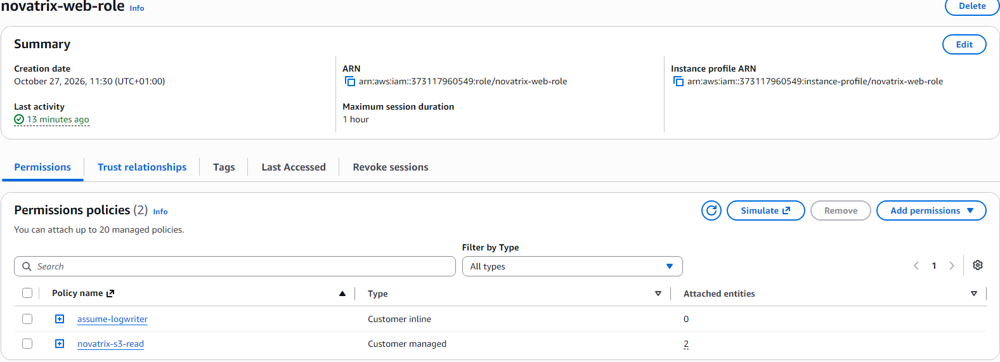
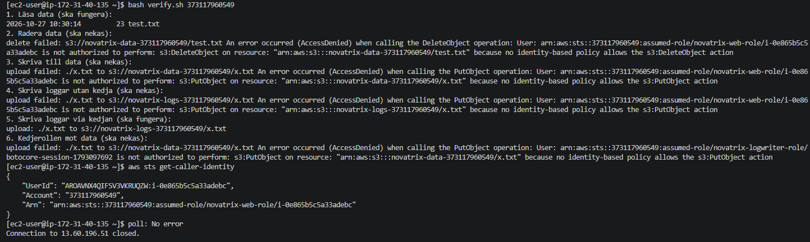

# AWS Uppgift 2 (v43) - IAM och identitet

**Namn:** Pontus Pihlström
**Kurs:** AWS
**Datum:** 2026-10-27
## Delmoment 1: Repo
Skapat mappen `V43` i kursrepot.

## Delmoment 2: Användare och grupper
Skapat IAM-grupper som speglar Novatrix roller:
*   **`drift`**: Sköter servrarna och har bredare behörigheter.
*   **`utveckling`**: Bygger appen och har begränsad åtkomst.

Skapat två testanvändare som lagts i respektive grupp:
*   `ops-anna` (i gruppen `drift`)
*   `dev-erik` (i gruppen `utveckling`)

**Verifiering:** Användarna syns i IAM-konsolen och är medlemmar i rätt grupper. 
*(Bild på gruppmedlemskap saknas, men verifierades i konsolen).*

## Delmoment 3: Policies enligt least privilege
För att undvika för breda rättigheter har jag skapat egna, snäva policies istället för att använda `AmazonS3ReadOnlyAccess`.

**`policies/s3-read.json`** (kopplad till gruppen `utveckling`):
```json
{
  "Version": "2012-10-17",
  "Statement": [
    { "Effect": "Allow", "Action": "s3:ListBucket",
      "Resource": "arn:aws:s3:::novatrix-data-373117960549" },
    { "Effect": "Allow", "Action": "s3:GetObject",
      "Resource": "arn:aws:s3:::novatrix-data-373117960549/*" }
  ]
}
```

Gruppen `drift` har tilldelats `AmazonEC2FullAccess` eftersom deras uppgift är att hantera servrarna. Denna policy är bredare än nödvändigt, men Access Advisor kan användas för att i framtiden snäva in den.

**Verifiering:** Policyn syns under gruppen `utveckling` i IAM-konsolen.

---

## Delmoment 4: Behörigheter mellan tjänster
Skapat en S3-bucket (`novatrix-data-373117960549`) med en testfil och skapat IAM-rollen **`novatrix-web-role`**. Rollen är kopplad till EC2-instansen via en instance profile, vilket gör att servern kan läsa från S3 utan att några nycklar finns i koden.

**Trust policy (`policies/trust-ec2.json`):**
```json
{
  "Version": "2012-10-17",
  "Statement": [{
    "Effect": "Allow",
    "Principal": { "Service": "ec2.amazonaws.com" },
    "Action": "sts:AssumeRole"
  }]
}
```




**Verifiering:** Rollen är kopplad till instansen och servern kan läsa från bucketen med kommandot `aws s3 ls s3://novatrix-data-373117960549`. (Att köra `aws s3 ls` utan bucket-namn nekas, eftersom policyn saknar `s3:ListAllMyBuckets`, vilket är avsiktligt).


---

## Delmoment 5: Verifiera och dokumentera
Verifieringen gjordes i två steg:

### 1. Från servern (via SSH)
Körde `verify.sh` som bevisar att rättigheterna fungerar:
*   **Steg 1:** Läsa data från bucketen fungerar.
*   **Steg 2 & 3:** Radera/skriva data nekas (AccessDenied).
*   **Steg 4:** Skriva loggar utan rollkedja nekas.
*   **Steg 5:** Skriva loggar via rollkedjan fungerar.
*   **Steg 6:** Kedjerollen mot databucketen nekas.

Körde sedan `aws sts get-caller-identity` för att bevisa att servern använder rollen utan nycklar.



### 2. Som dev-erik i webbläsaren
Loggade in som `dev-erik` i ett privat fönster och gick direkt till bucketens URL. Kunde se `test.txt` men fick **Access Denied** vid uppladdning av en ny fil. Detta bevisar att policyn är korrekt snäv.


*(Test av ops-anna: Jag loggade aldrig in som ops-anna för att verifiera hennes behörigheter, utan förlitade mig på att gruppen drift har AmazonEC2FullAccess)*

---

## VG: Flera samverkande roller i en kedja
För att uppnå VG-kravet har jag designat en rollkedja med två separata IAM-roller för att uppnå strikt least privilege mellan tjänsterna. Allt är automatiserat via `roller.sh`.

### Design av kedjan
1.  **`novatrix-web-role`**: Kopplad till EC2-instansen. Den får endast läsa från databucketen och anta nästa roll i kedjan.
2.  **`novatrix-logwriter-role`**: Får endast skriva (`s3:PutObject`) till loggbucketen (`novatrix-logs-...`). Dess trust policy litar på `novatrix-web-role`, vilket innebär att bara webbservern kan anta den.

### Motivering (Least Privilege)
Kedjan är medvetet uppdelad för att isolera risker:
*   Webbservern kan läsa data men **inte** ändra eller radera den.
*   Loggskrivaren kan bara skriva loggar men **inte** läsa data.
*   En komprometterad webbserver kan skriva till loggbucketen (via kedjan), men kan **aldrig** röra databucketen.

**Bevis på kedjan:** Loggrollens trust policy (se JSON-kod nedan) visar att Principal pekar på novatrix-web-roles ARN, vilket tvingar webbrollen att agera mellanhand.

### Så återskapas lösningen
Allt skapas från ett skript, `roller.sh`, med variabler överst. Skriptet skapar S3-buckets, IAM-grupper, användare, policies, båda rollerna och kopplar instance profilen till EC2-instansen.

```bash
# Körs från V43-mappen
bash roller.sh
```

För att verifiera, kör på servern:
```bash
bash verify.sh 373117960549
```

### Bilagor (Kod)

**`policies/trust-web-role.json`** (Loggrollens trust policy):
```json
{
  "Version": "2012-10-17",
  "Statement": [{
    "Effect": "Allow",
    "Principal": { "AWS": "arn:aws:iam::373117960549:role/novatrix-web-role" },
    "Action": "sts:AssumeRole"
  }]
}
```

**`policies/assume-logwriter.json`** (Webbrollens rätt att anta loggrollen):
```json
{
  "Version": "2012-10-17",
  "Statement": [{
    "Effect": "Allow",
    "Action": "sts:AssumeRole",
    "Resource": "arn:aws:iam::373117960549:role/novatrix-logwriter-role"
  }]
}
```

**`policies/log-write.json`** (Loggrollens skrivrätt):
```json
{
  "Version": "2012-10-17",
  "Statement": [{
    "Effect": "Allow",
    "Action": "s3:PutObject",
    "Resource": "arn:aws:s3:::novatrix-logs-373117960549/*"
  }]
}
```

**`V43/roller.sh`** (Huvudskriptet som skapar allt, se separat fil i repot).

**`V43/verify.sh`** (Verifieringsskriptet som körs på servern, se separat fil i repot).

---

## Begränsningar
*   SSH är endast öppet för min egen IP-adress.
*   Lösningen använder default-VPC i regionen Stockholm (`eu-north-1`).
*   Rollerna och bucketen behålls till kommande veckor enligt kursinstruktionerna.
*   En komprometterad webbserver kan skriva till loggbucketen (via kedjan), men inte läsa databucketen.
*   Drift-gruppen har bredare rättigheter (`AmazonEC2FullAccess`) än vad som strikt kanske behövs, vilket Access Advisor kan användas för att snäva in i framtiden.