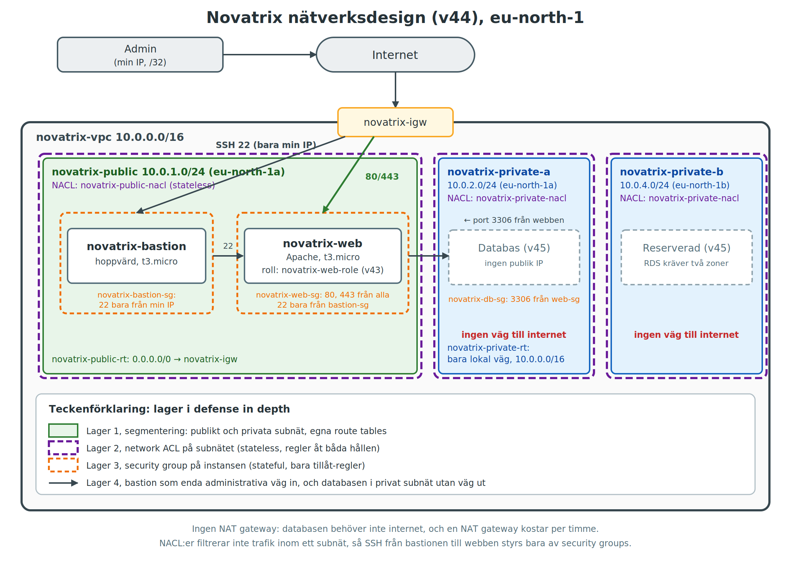

# AWS Uppgift 3 (v44) - Nätverk och säkerhet

**Namn:** Pontus Pihlström
**Kurs:** AWS, MOV25
**Datum:** 2026-11-02
**GitHub-repo:** https://github.com/01ponpih/AWS_MOV25

## Sammanfattning
Jag har byggt ett eget VPC åt Novatrix med ett publikt subnät för webbservern och två privata subnät förberedda för databasen (v45). För att uppnå defense in depth har jag satt upp segmentering, Network ACL:er, Security Groups och en bastion för att styra trafiken. Nätverket, identiteten och servrarna byggs med AWS CLI-skript. Kontots grundsäkerhet med MFA, adminanvändare, budget har satts upp manuellt tidigare veckor.

## Nätverksdesign




## Filer och arkitektur
Eftersom allt byggs via kod har jag delat upp det i oberoende steg som körs i rätt ordning av `deploy-all.sh`:

*   `deploy-all.sh`: Kör de tre stegen nedan i rätt ordning.
*   `vpc.sh`: Bygger nätverket (VPC, subnät, Internet Gateway, Route Tables, SGs och NACL:er).
*   `roller.sh`: Skapar IAM-roller, användare, policies och S3-buckets (från v43, ligger i V44).
*   `servers.sh`: Startar bastion och webbserver i det färdiga nätverket, med IAM-profilen kopplad.
*   `userdata.sh`: Körs på webbservern vid första start (installerar Apache och skriver webbsidan).
*   `verify-net.sh`: Testar och bevisar att trafikreglerna fungerar.
*   `teardown.sh`: River nätverket, servrarna, IAM-resurserna och S3-bucketarna.

## Delmoment 1: Repo
Mappen `V44` är skapad i kursrepot och rotens `README.md` har uppdaterats med en rad för vecka 44. Alla skript och denna dokumentation ligger i `V44`.

## Delmoment 2: Bygg VPC:t
Skriptet `vpc.sh` skapar VPC:t (`10.0.0.0/16`), ett publikt subnät (`10.0.1.0/24`) och två privata subnät (`10.0.2.0/24` och `10.0.4.0/24`). En Internet Gateway skapas och kopplas, men det är bara det publika subnätets Route Table som får en väg (`0.0.0.0/0`) ut till internet. De privata subnäten saknar denna väg och är helt isolerade.


## Delmoment 3: Säkra trafiken (Defense in Depth)

**1. Security Groups (Stateful, instansnivå):**

| Grupp | Inkommande | Motivering |
|-------|------------|------------|
| novatrix-bastion-sg | TCP 22 från min IP | Administration, bara från mig |
| novatrix-web-sg | TCP 80 och 443 från 0.0.0.0/0 | Webben ska nås av alla |
| novatrix-web-sg | TCP 22 från novatrix-bastion-sg | SSH bara via bastionen |
| novatrix-db-sg | TCP 3306 från novatrix-web-sg | Databasen nås bara av webbservern |

**2. Network ACLs (Stateless, subnätsnivå):**

*novatrix-public-nacl (publikt subnät)*
| Riktning | Regel | Protokoll, port | Källa/mål | Syfte |
|----------|-------|-----------------|-----------|-------|
| Inkommande | 100 | TCP 80 | 0.0.0.0/0 | HTTP |
| Inkommande | 110 | TCP 443 | 0.0.0.0/0 | HTTPS |
| Inkommande | 120 | TCP 22 | min IP /32 | SSH till bastionen |
| Inkommande | 130 | TCP 1024-65535 | 0.0.0.0/0 | Svarstrafik (stateless) |
| Utgående | 100 | TCP 80 | 0.0.0.0/0 | HTTP |
| Utgående | 110 | TCP 443 | 0.0.0.0/0 | HTTPS |
| Utgående | 120 | TCP 1024-65535 | 0.0.0.0/0 | Svarstrafik |
| Utgående | 130 | TCP 3306 | 10.0.2.0/24 | Webb till databas (v45) |
| Utgående | 140 | TCP 3306 | 10.0.4.0/24 | Webb till databas (v45) |

*novatrix-private-nacl (privata subnät)*
| Riktning | Regel | Protokoll, port | Källa/mål | Syfte |
|----------|-------|-----------------|-----------|-------|
| Inkommande | 100 | TCP 3306 | 10.0.1.0/24 | Bara publika subnätet når databasporten |
| Utgående | 100 | TCP 1024-65535 | 10.0.1.0/24 | Svar tillbaka till webben |


**Utdata från AWS (som text):**

```text
$ aws ec2 describe-vpcs --filters Name=tag:Name,Values=novatrix-vpc --query 'Vpcs[0].{VpcId:VpcId,Cidr:CidrBlock}' --output table
------------------------------------------
|              DescribeVpcs              |
+--------------+-------------------------+
|     Cidr     |          VpcId          |
+--------------+-------------------------+
|  10.0.0.0/16 |  vpc-06f1a88497b3bf662  |
+--------------+-------------------------+

$ aws ec2 describe-subnets --filters Name=vpc-id,Values=$(aws ec2 describe-vpcs --filters Name=tag:Name,Values=novatrix-vpc --query 'Vpcs[0].VpcId' --output text) --query 'Subnets[].{Name:Tags[?Key==`Name`].Value|[0],Cidr:CidrBlock,AZ:AvailabilityZone}' --output table
------------------------------------------------------
|                   DescribeSubnets                  |
+-------------+---------------+----------------------+
|     AZ      |     Cidr      |        Name          |
+-------------+---------------+----------------------+
|  eu-north-1a|  10.0.1.0/24  |  novatrix-public     |
|  eu-north-1a|  10.0.2.0/24  |  novatrix-private-a  |
|  eu-north-1b|  10.0.4.0/24  |  novatrix-private-b  |
+-------------+---------------+----------------------+
```


## Delmoment 4: Placera lösningen
Servrarna startas av `servers.sh` när nätverket och identiteten redan finns. Webbservern `novatrix-web` startas i `novatrix-public` med en publik IP och instance-profilen `novatrix-web-role` (från v43) kopplad. Bastionen `novatrix-bastion` startas i samma subnät. De två privata subnäten är tomma och förberedda för databasen i v45.

**Angående AMI-val:** Eftersom en instans inte kan byta VPC i efterhand, byggde jag istället om servern från kod för att hela miljön ska kunna återskapas från repot utan att vara beroende av en sparad snapshot. `servers.sh` startar instanserna från Amazons egen Amazon Linux 2023-image. Den hämtar imagen via SSM Parameter Store, med en reservväg som söker bland Amazons egna images om SSM-anropet misslyckas. Vid min körning misslyckades SSM-anropet och reservvägen användes, men jag har inte undersökt varför SSM misslyckades.


## Delmoment 5: Verifiering
Jag körde `verify-net.sh` för att bevisa att defense in depth fungerar. Skriptet använder `ProxyCommand` för att hoppa via bastionen, så min privata nyckel aldrig lämnar datorn.

```text
Bastion: 13.61.6.193   Webb: 13.60.223.200 (privat 10.0.1.228)
-----------------------------------------------------
1. HTTP mot webben (ska fungera):
HTTP 200
2. Stängd port 8080 (ska time-outa, curl-exit 28):
curl-exit: 28
3. SSH direkt mot webben (ska time-outa, ssh-exit 255):
ssh: connect to host 13.60.223.200 port 22: Connection timed out
ssh-exit: 255
4. SSH mot bastionen (ska fungera):
ip-10-0-1-31.eu-north-1.compute.internal
5. Via bastionen till webben, och S3 med rollen (ska fungera):
ip-10-0-1-228.eu-north-1.compute.internal
2026-11-02 11:37:44         23 test.txt
```

*Test 2 visar att trafik mot en stängd port stoppas. Enligt reglerna är det Security Group som stoppar den: NACL:en släpper igenom port 8080 (ligger i intervallet 1024-65535 som behövs för svarstrafik), men Security Group tillåter bara 80, 443 och SSH från bastionen. Detta är en slutsats från reglerna, inte något jag mätt separat per lager.*

IAM-verifieringen med sex tester gjordes i uppgift 2 (v43). I veckans uppgift visar test 5 ovan att rollen fungerar i det nya nätverket, eftersom servern läser från S3 utan nycklar.


## VG: Hot per lager
*   **Lager 1 (Segmentering):** Skyddar mot att en kapad webbserver får direktåtkomst till databasen. Känsliga resurser ligger i privata subnät utan väg ut.
*   **Lager 2 (NACL):** Ett brett filter på subnätet. Skyddar mot oönskade portar och fungerar som en säkerhetsventil om en Security Group skulle konfigureras fel.
*   **Lager 3 (Security Group):** Det specifika låset på instansen. Skyddar mot portskanningar och obehörig SSH-åtkomst direkt utifrån.
*   **Lager 4 (Bastion):** Enda vägen in för administration. Skyddar webbserverns SSH-port från brute force-attacker utifrån.
*   **Lager 5 (IAM från v43):** Begränsar vad en angripare kan göra *om* de tar sig in på servern. Rollen kan bara läsa en specifik S3-bucket och anta loggrollen, som bara får skriva loggar.

## Så återskapas lösningen

**Förutsättningar:**
*   AWS CLI v2 installerat.
*   Inloggad som en IAM-användare med administratörsbehörighet (aldrig root).
*   Region `eu-north-1` konfigurerad.

Från `V44`-mappen:

```bash
# Bygg allt från scratch
bash deploy-all.sh

# Verifiera
bash verify-net.sh ./novatrix-key.pem
```

`roller.sh` skapar S3-buckets, IAM-användare och roller (och kan köras om utan att krascha eftersom det kontrollerar om resurserna redan finns). Det skriver också ut lösenord för testanvändarna `ops-anna` och `dev-erik` vid första körningen. Dessa sparas aldrig i repot.

Om nyckelparet eller `.pem`-filen saknas skapar `servers.sh` ett nytt par och skriver ut vilken fil som ska användas.

## Städning och kostnad
Servrarna, nätverket, IAM-rollerna och S3-bucketarna tas bort med `bash teardown.sh`. Detta görs för att inga onödiga resurser ska ligga och kosta pengar efter avslutad uppgift.

VPC, subnät, route tables, gateway, security groups och NACL:er kostar inget i sig, men instanserna och deras publika IP-adresser kostar så länge de körs. 

Det enda som inte tas bort av skriptet är kontots grundsäkerhet (MFA, adminanvändare och budget), eftersom det ligger på kontonivå och inte skapades av skripten. Hela projektmiljön kan enkelt återskapas nästa vecka genom att köra `bash deploy-all.sh` igen.

## Begränsningar
*   Min publika IP står i `novatrix-bastion-sg` och i NACL-regel 120. Ändras den måste `teardown.sh` och `deploy-all.sh` köras igen.
*   NACL:er filtrerar inte trafik inom samma subnät, så SSH mellan bastion och webbserver styrs bara av security groups.
*   Bastionen och webbservern ligger i samma publika subnät. En striktare design hade placerat dem i separata subnät.
*   Webbservern ligger i en enda availability zone.
*   Port 443 är öppen i reglerna, men ingen HTTPS-tjänst är uppsatt (HTTP utan certifikat).
*   `3306` i databasreglerna antar MySQL.


## Bilaga: Skript

Nedan följer de fullständiga skript som användes för att bygga och verifiera miljön.

### `deploy-all.sh`
```bash
#!/bin/bash
set -e
cd "$(dirname "$0")"

echo "== 1/3: Nätverk =="
bash vpc.sh

echo "== 2/3: Identitet och lagring =="
bash roller.sh

echo "== 3/3: Servrar =="
bash servers.sh

echo "====================================================="
echo "Klart! Verifiera nätverket med:"
echo "bash verify-net.sh ../V42/novatrix-key.pem"
echo "====================================================="
```

### `vpc.sh`
```bash
#!/bin/bash
set -eE
export AWS_PAGER=""
export AWS_DEFAULT_REGION="eu-north-1"
cd "$(dirname "$0")"

trap 'echo "FEL på rad $LINENO. Kör bash teardown-vpc.sh innan du försöker igen."' ERR

AZ_A="eu-north-1a"
AZ_B="eu-north-1b"

CALLER_ARN=$(aws sts get-caller-identity --query Arn --output text)
if [[ "$CALLER_ARN" == *":root" ]]; then
  echo "FEL: Du kör som root. Använd din adminanvändare."; exit 1
fi

EXISTING_VPC=$(aws ec2 describe-vpcs --filters Name=tag:Name,Values=novatrix-vpc \
  --query 'Vpcs[0].VpcId' --output text)
if [ "$EXISTING_VPC" != "None" ]; then
  echo "FEL: novatrix-vpc finns redan ($EXISTING_VPC). Kör teardown-vpc.sh först."
  exit 1
fi

MY_IP=$(curl -s https://checkip.amazonaws.com | tr -d '\n')
echo "Min IP: $MY_IP"

tag() { aws ec2 create-tags --resources "$1" --tags Key=Name,Value="$2"; }
acl() {
  aws ec2 create-network-acl-entry --network-acl-id "$1" --rule-number "$2" --"$3" \
    --protocol tcp --port-range From="$5",To="$6" --cidr-block "$4" --rule-action allow
}
use_nacl() {
  ASSOC=$(aws ec2 describe-network-acls --filters Name=association.subnet-id,Values="$1" \
    --query "NetworkAcls[0].Associations[?SubnetId=='$1'].NetworkAclAssociationId" --output text)
  aws ec2 replace-network-acl-association --association-id "$ASSOC" --network-acl-id "$2" >/dev/null
}

echo "Skapar VPC och subnät..."
VPC_ID=$(aws ec2 create-vpc --cidr-block 10.0.0.0/16 --query Vpc.VpcId --output text)
tag "$VPC_ID" novatrix-vpc

mk_subnet() { aws ec2 create-subnet --vpc-id "$VPC_ID" --cidr-block "$1" \
  --availability-zone "$2" --query Subnet.SubnetId --output text; }
PUB_ID=$(mk_subnet 10.0.1.0/24 "$AZ_A");  tag "$PUB_ID" novatrix-public
PRIV_A=$(mk_subnet 10.0.2.0/24 "$AZ_A");  tag "$PRIV_A" novatrix-private-a
PRIV_B=$(mk_subnet 10.0.4.0/24 "$AZ_B");  tag "$PRIV_B" novatrix-private-b
aws ec2 modify-subnet-attribute --subnet-id "$PUB_ID" --map-public-ip-on-launch

echo "Skapar gateway och routing..."
IGW_ID=$(aws ec2 create-internet-gateway --query InternetGateway.InternetGatewayId --output text)
tag "$IGW_ID" novatrix-igw
aws ec2 attach-internet-gateway --internet-gateway-id "$IGW_ID" --vpc-id "$VPC_ID"

PUB_RT=$(aws ec2 create-route-table --vpc-id "$VPC_ID" --query RouteTable.RouteTableId --output text)
tag "$PUB_RT" novatrix-public-rt
aws ec2 create-route --route-table-id "$PUB_RT" --destination-cidr-block 0.0.0.0/0 --gateway-id "$IGW_ID" >/dev/null
aws ec2 associate-route-table --route-table-id "$PUB_RT" --subnet-id "$PUB_ID" >/dev/null

PRIV_RT=$(aws ec2 create-route-table --vpc-id "$VPC_ID" --query RouteTable.RouteTableId --output text)
tag "$PRIV_RT" novatrix-private-rt
aws ec2 associate-route-table --route-table-id "$PRIV_RT" --subnet-id "$PRIV_A" >/dev/null
aws ec2 associate-route-table --route-table-id "$PRIV_RT" --subnet-id "$PRIV_B" >/dev/null

echo "Skapar security groups..."
mk_sg() { aws ec2 create-security-group --group-name "$1" --description "$2" \
  --vpc-id "$VPC_ID" --query GroupId --output text; }
BASTION_SG=$(mk_sg novatrix-bastion-sg "SSH fran admin-IP")
WEB_SG=$(mk_sg novatrix-web-sg "Webb och SSH fran bastion")
DB_SG=$(mk_sg novatrix-db-sg "Databas fran webben")

aws ec2 authorize-security-group-ingress --group-id "$BASTION_SG" --protocol tcp --port 22 --cidr "${MY_IP}/32" >/dev/null
aws ec2 authorize-security-group-ingress --group-id "$WEB_SG" --protocol tcp --port 80 --cidr 0.0.0.0/0 >/dev/null
aws ec2 authorize-security-group-ingress --group-id "$WEB_SG" --protocol tcp --port 443 --cidr 0.0.0.0/0 >/dev/null
aws ec2 authorize-security-group-ingress --group-id "$WEB_SG" --protocol tcp --port 22 --source-group "$BASTION_SG" >/dev/null
aws ec2 authorize-security-group-ingress --group-id "$DB_SG" --protocol tcp --port 3306 --source-group "$WEB_SG" >/dev/null

echo "Skapar network ACL:er..."
PUB_NACL=$(aws ec2 create-network-acl --vpc-id "$VPC_ID" --query NetworkAcl.NetworkAclId --output text)
tag "$PUB_NACL" novatrix-public-nacl
acl "$PUB_NACL" 100 ingress 0.0.0.0/0 80 80
acl "$PUB_NACL" 110 ingress 0.0.0.0/0 443 443
acl "$PUB_NACL" 120 ingress "${MY_IP}/32" 22 22
acl "$PUB_NACL" 130 ingress 0.0.0.0/0 1024 65535
acl "$PUB_NACL" 100 egress  0.0.0.0/0 80 80
acl "$PUB_NACL" 110 egress  0.0.0.0/0 443 443
acl "$PUB_NACL" 120 egress  0.0.0.0/0 1024 65535
acl "$PUB_NACL" 130 egress  10.0.2.0/24 3306 3306
acl "$PUB_NACL" 140 egress  10.0.4.0/24 3306 3306
use_nacl "$PUB_ID" "$PUB_NACL"

PRIV_NACL=$(aws ec2 create-network-acl --vpc-id "$VPC_ID" --query NetworkAcl.NetworkAclId --output text)
tag "$PRIV_NACL" novatrix-private-nacl
acl "$PRIV_NACL" 100 ingress 10.0.1.0/24 3306 3306
acl "$PRIV_NACL" 100 egress  10.0.1.0/24 1024 65535
use_nacl "$PRIV_A" "$PRIV_NACL"
use_nacl "$PRIV_B" "$PRIV_NACL"

echo "====================================================="
echo "Nätverket är klart: $VPC_ID"
echo "Nästa steg: identitet (V43/roller.sh), sedan servrar (V44/servers.sh)."
echo "====================================================="
```

### `roller.sh`
```bash
#!/bin/bash
set -e

export AWS_PAGER=""

# SÄKERHETSSPÄRR: Kör inte som root
CALLER_ARN=$(aws sts get-caller-identity --query Arn --output text)
if [[ "$CALLER_ARN" == *"root"* ]]; then
  echo "FEL: Du kör som root. Logga in som din admin-användare och kör igen."
  exit 1
fi

REGION="eu-north-1"
export AWS_DEFAULT_REGION="$REGION"
ACCOUNT_ID=$(aws sts get-caller-identity --query Account --output text)

DATA_BUCKET="novatrix-data-${ACCOUNT_ID}"
LOG_BUCKET="novatrix-logs-${ACCOUNT_ID}"
WEB_ROLE="novatrix-web-role"
LOG_ROLE="novatrix-logwriter-role"
READ_POLICY="novatrix-s3-read"
INSTANCE_TAG="novatrix-web"
READ_ARN="arn:aws:iam::${ACCOUNT_ID}:policy/${READ_POLICY}"

echo "Konto-ID: $ACCOUNT_ID"
mkdir -p policies

cat > policies/trust-ec2.json << 'EOF'
{
  "Version": "2012-10-17",
  "Statement": [{
    "Effect": "Allow",
    "Principal": { "Service": "ec2.amazonaws.com" },
    "Action": "sts:AssumeRole"
  }]
}
EOF

cat > policies/s3-read.json << EOF
{
  "Version": "2012-10-17",
  "Statement": [
    { "Effect": "Allow", "Action": "s3:ListBucket",
      "Resource": "arn:aws:s3:::${DATA_BUCKET}" },
    { "Effect": "Allow", "Action": "s3:GetObject",
      "Resource": "arn:aws:s3:::${DATA_BUCKET}/*" }
  ]
}
EOF

cat > policies/assume-logwriter.json << EOF
{
  "Version": "2012-10-17",
  "Statement": [{
    "Effect": "Allow",
    "Action": "sts:AssumeRole",
    "Resource": "arn:aws:iam::${ACCOUNT_ID}:role/${LOG_ROLE}"
  }]
}
EOF

cat > policies/trust-web-role.json << EOF
{
  "Version": "2012-10-17",
  "Statement": [{
    "Effect": "Allow",
    "Principal": { "AWS": "arn:aws:iam::${ACCOUNT_ID}:role/${WEB_ROLE}" },
    "Action": "sts:AssumeRole"
  }]
}
EOF

cat > policies/log-write.json << EOF
{
  "Version": "2012-10-17",
  "Statement": [{
    "Effect": "Allow",
    "Action": "s3:PutObject",
    "Resource": "arn:aws:s3:::${LOG_BUCKET}/*"
  }]
}
EOF

for B in "$DATA_BUCKET" "$LOG_BUCKET"; do
  if aws s3api head-bucket --bucket "$B" 2>/dev/null; then
    echo "Bucket $B finns redan."
  else
    aws s3api create-bucket --bucket "$B" --create-bucket-configuration LocationConstraint="$REGION" >/dev/null
    aws s3api put-public-access-block --bucket "$B" --public-access-block-configuration \
      BlockPublicAcls=true,IgnorePublicAcls=true,BlockPublicPolicy=true,RestrictPublicBuckets=true
  fi
done

echo "Testfil från Novatrix" > test.txt
aws s3 cp test.txt "s3://${DATA_BUCKET}/test.txt" >/dev/null
rm -f test.txt

for G in drift utveckling; do
  aws iam get-group --group-name "$G" >/dev/null 2>&1 || aws iam create-group --group-name "$G" >/dev/null
done

aws iam get-policy --policy-arn "$READ_ARN" >/dev/null 2>&1 || \
  aws iam create-policy --policy-name "$READ_POLICY" --policy-document file://policies/s3-read.json >/dev/null

aws iam attach-group-policy --group-name drift --policy-arn arn:aws:iam::aws:policy/AmazonEC2FullAccess
aws iam attach-group-policy --group-name utveckling --policy-arn "$READ_ARN"

for U in ops-anna dev-erik; do
  aws iam get-user --user-name "$U" >/dev/null 2>&1 || aws iam create-user --user-name "$U" >/dev/null
done
aws iam add-user-to-group --user-name ops-anna --group-name drift
aws iam add-user-to-group --user-name dev-erik --group-name utveckling

for U in ops-anna dev-erik; do
  if ! aws iam get-login-profile --user-name "$U" >/dev/null 2>&1; then
    # Slumpar fram ett starkt lösenord
    PW="$(openssl rand -base64 12)Aa1!"
    aws iam create-login-profile --user-name "$U" --password "$PW" --no-password-reset-required >/dev/null
    echo "Lösenord för $U: $PW  (spara undan, visas bara nu)"
  fi
done

if ! aws iam get-role --role-name "$WEB_ROLE" >/dev/null 2>&1; then
  aws iam create-role --role-name "$WEB_ROLE" --assume-role-policy-document file://policies/trust-ec2.json >/dev/null
fi
aws iam attach-role-policy --role-name "$WEB_ROLE" --policy-arn "$READ_ARN"
aws iam put-role-policy --role-name "$WEB_ROLE" --policy-name assume-logwriter --policy-document file://policies/assume-logwriter.json

echo "Väntar på att IAM ska sprida $WEB_ROLE så att Roll 2 kan skapas..."
for i in {1..10}; do
  if aws iam get-role --role-name "$WEB_ROLE" >/dev/null 2>&1; then
    break
  fi
  sleep 5
done
sleep 10 # Extra säkerhetsmarginal

if ! aws iam get-role --role-name "$LOG_ROLE" >/dev/null 2>&1; then
  for i in {1..6}; do
    if aws iam create-role --role-name "$LOG_ROLE" --assume-role-policy-document file://policies/trust-web-role.json >/dev/null 2>&1; then
      break
    fi
    echo "Försöker skapa Roll 2 igen ($i/6)..."
    sleep 10
  done
fi
aws iam put-role-policy --role-name "$LOG_ROLE" --policy-name log-write --policy-document file://policies/log-write.json

if ! aws iam get-instance-profile --instance-profile-name "$WEB_ROLE" >/dev/null 2>&1; then
  aws iam create-instance-profile --instance-profile-name "$WEB_ROLE" >/dev/null
  aws iam add-role-to-instance-profile --instance-profile-name "$WEB_ROLE" --role-name "$WEB_ROLE"
fi

echo "Väntar 15 sekunder på att IAM ska sprida ändringarna..."
sleep 15

INSTANCE_ID=$(aws ec2 describe-instances \
  --filters "Name=tag:Name,Values=$INSTANCE_TAG" "Name=instance-state-name,Values=running" \
  --query 'Reservations[0].Instances[0].InstanceId' --output text)

if [ "$INSTANCE_ID" = "None" ]; then
  echo "Ingen körande instans '$INSTANCE_TAG' än. Profilen kopplas när servers.sh startar webbservern."
else
  EXISTING=$(aws ec2 describe-iam-instance-profile-associations \
    --filters "Name=instance-id,Values=$INSTANCE_ID" "Name=state,Values=associated" \
    --query 'IamInstanceProfileAssociations[0].AssociationId' --output text)

  OK=0
  for i in 1 2 3 4 5 6; do
    if [ "$EXISTING" = "None" ]; then
      aws ec2 associate-iam-instance-profile --instance-id "$INSTANCE_ID" --iam-instance-profile Name="$WEB_ROLE" >/dev/null && OK=1 && break
    else
      aws ec2 replace-iam-instance-profile-association --association-id "$EXISTING" --iam-instance-profile Name="$WEB_ROLE" >/dev/null && OK=1 && break
    fi
    echo "Profilen är inte klar än, försöker igen om 10 sekunder ($i/6)..."
    sleep 10
  done

  if [ "$OK" = "1" ]; then
    echo "Profilen kopplad till $INSTANCE_ID"
  else
    echo "FEL: Kunde inte koppla profilen. Gör det i EC2: Actions, Security, Modify IAM role."
    exit 1
  fi
fi

echo "====================================================="
echo "Klart! Data-bucket: $DATA_BUCKET  Logg-bucket: $LOG_BUCKET"
echo "====================================================="
```

### `servers.sh`
```bash
#!/bin/bash
set -eE
export AWS_PAGER=""
export AWS_DEFAULT_REGION="eu-north-1"
cd "$(dirname "$0")"

trap 'echo "FEL på rad $LINENO."' ERR

KEY_NAME="novatrix-key"
INSTANCE_TYPE="t3.micro"
WEB_PROFILE="novatrix-web-role"

CALLER_ARN=$(aws sts get-caller-identity --query Arn --output text)
if [[ "$CALLER_ARN" == *":root" ]]; then
  echo "FEL: Du kör som root. Använd din adminanvändare."; exit 1
fi

[ -f userdata.sh ] || { echo "FEL: userdata.sh saknas i $(pwd)."; exit 1; }

if ! aws iam get-instance-profile --instance-profile-name "$WEB_PROFILE" >/dev/null 2>&1; then
  echo "FEL: Instance profile $WEB_PROFILE saknas. Kör först: bash roller.sh"
  exit 1
fi

VPC_ID=$(aws ec2 describe-vpcs --filters Name=tag:Name,Values=novatrix-vpc --query 'Vpcs[0].VpcId' --output text)
[ "$VPC_ID" != "None" ] || { echo "FEL: novatrix-vpc saknas. Kör bash vpc.sh först."; exit 1; }

PUB_ID=$(aws ec2 describe-subnets --filters Name=vpc-id,Values="$VPC_ID" Name=tag:Name,Values=novatrix-public --query 'Subnets[0].SubnetId' --output text)
sg() { aws ec2 describe-security-groups --filters Name=vpc-id,Values="$VPC_ID" Name=group-name,Values="$1" --query 'SecurityGroups[0].GroupId' --output text; }
BASTION_SG=$(sg novatrix-bastion-sg)
WEB_SG=$(sg novatrix-web-sg)

RUNNING=$(aws ec2 describe-instances --filters Name=vpc-id,Values="$VPC_ID" "Name=tag:Name,Values=novatrix-web,novatrix-bastion" Name=instance-state-name,Values=pending,running --query 'Reservations[].Instances[].InstanceId' --output text)
if [ -n "$RUNNING" ]; then
  echo "FEL: Servrar finns redan ($RUNNING). Kör teardown-vpc.sh först."; exit 1
fi

KEY_FILE=""
for P in "./${KEY_NAME}.pem" "../V42/${KEY_NAME}.pem"; do
  if [ -f "$P" ]; then KEY_FILE="$P"; break; fi
done
if ! aws ec2 describe-key-pairs --key-names "$KEY_NAME" >/dev/null 2>&1; then
  aws ec2 create-key-pair --key-name "$KEY_NAME" --query 'KeyMaterial' --output text > "${KEY_NAME}.pem"
  chmod 400 "${KEY_NAME}.pem"
  KEY_FILE="./${KEY_NAME}.pem"
  echo "Nytt nyckelpar skapat: $KEY_FILE"
elif [ -z "$KEY_FILE" ]; then
  echo "VARNING: Nyckelpar $KEY_NAME finns i AWS men ingen .pem hittades lokalt. SSH kommer inte fungera."
fi

# Hämta AMI med fallback
echo "Hämtar AMI-ID..."
AMI_ID=$(aws ssm get-parameters --names /aws/service/ami-amazon-linux-latest/al2023-ami-kernel-default-x86_64 --query "Parameters[0].Value" --output text 2>/dev/null || true)
if [ -z "$AMI_ID" ] || [ "$AMI_ID" == "None" ]; then
  echo "SSM misslyckades, söker direkt bland AMIs..."
  AMI_ID=$(aws ec2 describe-images --owners amazon \
    --filters "Name=name,Values=al2023-ami-2023*" "Name=architecture,Values=x86_64" \
    --query "sort_by(Images, &CreationDate)[-1].ImageId" --output text)
fi

if [ -z "$AMI_ID" ] || [ "$AMI_ID" == "None" ]; then
  echo "FEL: Kunde inte hitta något AMI. Kontrollera din region."
  exit 1
fi
echo "Använder AMI: $AMI_ID"

echo "Startar bastion och webbserver..."
BASTION_ID=$(aws ec2 run-instances --image-id "$AMI_ID" --instance-type "$INSTANCE_TYPE" \
  --key-name "$KEY_NAME" --subnet-id "$PUB_ID" --security-group-ids "$BASTION_SG" \
  --tag-specifications "ResourceType=instance,Tags=[{Key=Name,Value=novatrix-bastion}]" \
  --query 'Instances[0].InstanceId' --output text)

WEB_ID=""
for i in 1 2 3 4 5 6; do
  WEB_ID=$(aws ec2 run-instances --image-id "$AMI_ID" --instance-type "$INSTANCE_TYPE" \
    --key-name "$KEY_NAME" --subnet-id "$PUB_ID" --security-group-ids "$WEB_SG" \
    --iam-instance-profile Name="$WEB_PROFILE" --user-data file://userdata.sh \
    --tag-specifications "ResourceType=instance,Tags=[{Key=Name,Value=novatrix-web}]" \
    --query 'Instances[0].InstanceId' --output text) && break
  echo "Profilen är inte klar än, försöker igen om 10 sekunder ($i/6)..."
  sleep 10
done
[ -n "$WEB_ID" ] || { echo "FEL: kunde inte starta webbservern."; exit 1; }

echo "Väntar på att instanserna ska bli klara..."
aws ec2 wait instance-status-ok --instance-ids "$BASTION_ID" "$WEB_ID"

ip() { aws ec2 describe-instances --instance-ids "$1" --query "Reservations[0].Instances[0].$2" --output text; }
echo "====================================================="
echo "Bastion: $(ip "$BASTION_ID" PublicIpAddress)"
echo "Webb:    http://$(ip "$WEB_ID" PublicIpAddress)  (privat IP $(ip "$WEB_ID" PrivateIpAddress))"
echo "Kör nu:  bash verify-net.sh ${KEY_FILE:-<sökväg-till-pem>}"
echo "====================================================="
```

### `userdata.sh`
```bash
#!/bin/bash
dnf update -y
dnf install -y httpd
systemctl start httpd
systemctl enable httpd

cat << 'HTML' > /var/www/html/index.html
<!DOCTYPE html>
<html lang="sv">
<head>
    <meta charset="UTF-8">
    <title>Novatrix AB</title>
</head>
<body>
    <h1>Novatrix AB</h1>
    <p>Vi bygger moderna digitala system f&ouml;r f&ouml;retag som vill v&auml;xa.</p>
    <p>Denna server k&ouml;rs i ett eget VPC med defense in depth.</p>
</body>
</html>
HTML
```

### `verify-net.sh`
```bash
#!/bin/bash
export AWS_PAGER=""
export AWS_DEFAULT_REGION="eu-north-1"

KEY="$1"
if [ ! -f "$KEY" ]; then
  echo "Ange sökvägen till .pem-filen. Exempel: bash verify-net.sh ../V42/novatrix-key.pem"
  exit 1
fi
ACCOUNT_ID=$(aws sts get-caller-identity --query Account --output text)

get() { aws ec2 describe-instances \
  --filters "Name=tag:Name,Values=$1" "Name=instance-state-name,Values=running" \
  --query "Reservations[0].Instances[0].$2" --output text; }
BASTION_IP=$(get novatrix-bastion PublicIpAddress)
WEB_IP=$(get novatrix-web PublicIpAddress)
WEB_PRIV=$(get novatrix-web PrivateIpAddress)
echo "Bastion: $BASTION_IP   Webb: $WEB_IP (privat $WEB_PRIV)"
echo "-----------------------------------------------------"

echo "1. HTTP mot webben (ska fungera):"
curl -s -o /dev/null -m 5 -w "HTTP %{http_code}\n" "http://$WEB_IP"

echo "2. Stängd port 8080 (ska time-outa, curl-exit 28):"
curl -s -o /dev/null -m 5 "http://$WEB_IP:8080"; echo "curl-exit: $?"

echo "3. SSH direkt mot webben (ska time-outa, ssh-exit 255):"
ssh -i "$KEY" -o ConnectTimeout=5 -o BatchMode=yes "ec2-user@$WEB_IP" true; echo "ssh-exit: $?"

echo "4. SSH mot bastionen (ska fungera):"
ssh -i "$KEY" -o StrictHostKeyChecking=accept-new "ec2-user@$BASTION_IP" hostname

echo "5. Via bastionen till webben, och S3 med rollen (ska fungera):"
ssh -i "$KEY" -o StrictHostKeyChecking=accept-new \
  -o ProxyCommand="ssh -i $KEY -o StrictHostKeyChecking=accept-new -W %h:%p ec2-user@$BASTION_IP" \
  "ec2-user@$WEB_PRIV" "hostname; aws s3 ls s3://novatrix-data-$ACCOUNT_ID"
```

### `teardown.sh`
```bash
#!/bin/bash
export AWS_PAGER=""
export AWS_DEFAULT_REGION="eu-north-1"

echo "=== 1/2: Städar nätverk och servrar ==="
VPC_ID=$(aws ec2 describe-vpcs --filters Name=tag:Name,Values=novatrix-vpc \
  --query 'Vpcs[0].VpcId' --output text)
if [ "$VPC_ID" = "None" ]; then 
  echo "Inget novatrix-vpc hittades."
else
  echo "Rensar $VPC_ID..."
  INSTANCES=$(aws ec2 describe-instances --filters Name=vpc-id,Values="$VPC_ID" \
    Name=instance-state-name,Values=pending,running,stopping,stopped \
    --query 'Reservations[].Instances[].InstanceId' --output text)
  if [ -n "$INSTANCES" ]; then
    aws ec2 terminate-instances --instance-ids $INSTANCES >/dev/null
    aws ec2 wait instance-terminated --instance-ids $INSTANCES
  fi

  for SG in novatrix-db-sg novatrix-web-sg novatrix-bastion-sg; do
    ID=$(aws ec2 describe-security-groups \
      --filters Name=vpc-id,Values="$VPC_ID" Name=group-name,Values="$SG" \
      --query 'SecurityGroups[0].GroupId' --output text)
    if [ "$ID" != "None" ]; then aws ec2 delete-security-group --group-id "$ID"; fi
  done

  for S in $(aws ec2 describe-subnets --filters Name=vpc-id,Values="$VPC_ID" \
    --query 'Subnets[].SubnetId' --output text); do
    aws ec2 delete-subnet --subnet-id "$S"
  done

  for N in $(aws ec2 describe-network-acls --filters Name=vpc-id,Values="$VPC_ID" \
    --query 'NetworkAcls[?IsDefault==`false`].NetworkAclId' --output text); do
    aws ec2 delete-network-acl --network-acl-id "$N"
  done

  for R in $(aws ec2 describe-route-tables --filters Name=vpc-id,Values="$VPC_ID" \
    --query 'RouteTables[?length(Associations[?Main==`true`])==`0`].RouteTableId' --output text); do
    aws ec2 delete-route-table --route-table-id "$R"
  done

  IGW=$(aws ec2 describe-internet-gateways --filters Name=attachment.vpc-id,Values="$VPC_ID" \
    --query 'InternetGateways[0].InternetGatewayId' --output text)
  if [ "$IGW" != "None" ]; then
    aws ec2 detach-internet-gateway --internet-gateway-id "$IGW" --vpc-id "$VPC_ID"
    aws ec2 delete-internet-gateway --internet-gateway-id "$IGW"
  fi

  if aws ec2 delete-vpc --vpc-id "$VPC_ID"; then
    echo "Nätverket borttaget."
  else
    echo "VARNING: VPC:t kunde inte tas bort, se felet ovan."; exit 1
  fi
fi

echo ""
echo "=== 2/2: Städar IAM, buckets och användare ==="
ACCOUNT_ID=$(aws sts get-caller-identity --query Account --output text)
READ_ARN="arn:aws:iam::${ACCOUNT_ID}:policy/novatrix-s3-read"
WEB_ROLE="novatrix-web-role"; LOG_ROLE="novatrix-logwriter-role"

ASSOC=$(aws ec2 describe-iam-instance-profile-associations \
  --filters "Name=state,Values=associated" \
  --query "IamInstanceProfileAssociations[?IamInstanceProfile.Arn=='arn:aws:iam::${ACCOUNT_ID}:instance-profile/${WEB_ROLE}'].AssociationId | [0]" --output text)
[ "$ASSOC" != "None" ] && aws ec2 disassociate-iam-instance-profile --association-id "$ASSOC"

aws iam remove-role-from-instance-profile --instance-profile-name $WEB_ROLE --role-name $WEB_ROLE || true
aws iam delete-instance-profile --instance-profile-name $WEB_ROLE || true
aws iam delete-role-policy --role-name $WEB_ROLE --policy-name assume-logwriter || true
aws iam detach-role-policy --role-name $WEB_ROLE --policy-arn $READ_ARN || true
aws iam delete-role --role-name $WEB_ROLE || true
aws iam delete-role-policy --role-name $LOG_ROLE --policy-name log-write || true
aws iam delete-role --role-name $LOG_ROLE || true

for U in ops-anna dev-erik; do
  aws iam delete-login-profile --user-name $U || true
done
aws iam remove-user-from-group --user-name ops-anna --group-name drift || true
aws iam remove-user-from-group --user-name dev-erik --group-name utveckling || true
aws iam delete-user --user-name ops-anna || true
aws iam delete-user --user-name dev-erik || true

aws iam detach-group-policy --group-name drift --policy-arn arn:aws:iam::aws:policy/AmazonEC2FullAccess || true
aws iam detach-group-policy --group-name utveckling --policy-arn $READ_ARN || true
aws iam delete-group --group-name drift || true
aws iam delete-group --group-name utveckling || true
aws iam delete-policy --policy-arn $READ_ARN || true

aws s3 rb "s3://novatrix-data-${ACCOUNT_ID}" --force || true
aws s3 rb "s3://novatrix-logs-${ACCOUNT_ID}" --force || true

echo ""
echo "====================================================="
echo "Allt städat! Du kan nu köra: bash deploy-all.sh"
echo "====================================================="
```